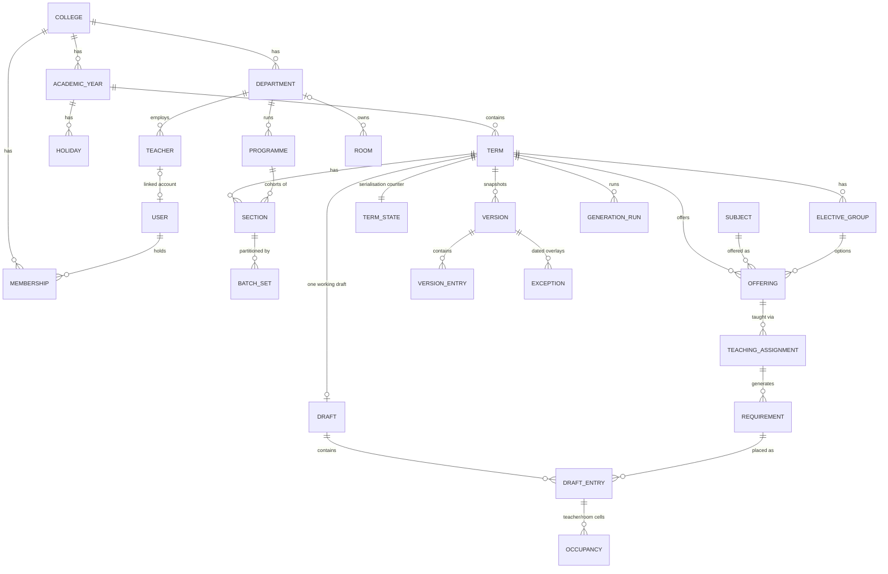

# DATABASE_DESIGN.md

MongoDB data model for College Timetable Optimizer: collections, relationships, indexes, tenant scoping, transactions and concurrency control. Concepts and rules are defined in `PRODUCT_REQUIREMENTS.md` (sections 3, 4, 6) and `SCHEDULING_ENGINE.md`.

Database: MongoDB Atlas, Mumbai region, replica set (M8). ODM: Mongoose (M10). Status: design.

---

## 1. Conventions

- **Ids:** MongoDB `ObjectId` for every document. Natural keys (subject code, room code, employee id) are unique per college but never used as references.
- **Tenant field:** every college-owned document has `collegeId: ObjectId` (required, immutable). Every index on a tenant collection starts with `collegeId`. Cross-references (e.g. an entry's `roomId`) must point to a document with the **same** `collegeId`; the repository layer checks this on write (MongoDB has no foreign keys).
- **Term scope:** term-specific data also carries `termId` (second key in indexes).
- **Timestamps:** `createdAt`, `updatedAt` (UTC). Dates without time (holidays, exceptions) are stored as `YYYY-MM-DD` strings in the college's time zone (Asia/Kolkata, D9), so they never shift across time zones.
- **Optimistic concurrency:** every editable document has `rowVersion: number`. Updates use `{ _id, collegeId, rowVersion: expected }` as the filter and `$inc: { rowVersion: 1 }`; no match means `409 version_conflict`.
- **Soft delete:** master data is deactivated (`active: false`) rather than deleted once it is referenced by any draft or version, so history stays readable.
- **Bilingual labels:** `name: { en: string, pa?: string }` for colleges, departments, programmes, subjects, rooms. People's names are stored as entered (`name`), with an optional `namePa`.
- **Validation in two places:** Zod at the API boundary (`packages/contracts`) and Mongoose schemas (`strict: true`, `strictQuery: true`, `sanitizeFilter: true`). Critical invariants (e.g. `collegeId` present) are also enforced with MongoDB collection validators (`$jsonSchema`) on every tenant collection, so a bug that bypasses Mongoose still cannot write a tenant document without a college. `jobs` is the one cross-tenant infrastructure collection (platform jobs have no college); its validator requires `collegeId` for every tenant job type.

## 2. Collections overview

```
Platform (no collegeId)            Tenant (collegeId on every document)
───────────────────────            ──────────────────────────────────────────────
users                              memberships          invitations
sessions                           academicYears        terms           holidays
passwordResets                     departments          programmes
rateLimits                         timeGrids            rooms
colleges                           teachers             teacherAvailability
platformAuditEvents                subjects             offerings
migrations                         sections             batchSets       electiveGroups
                                   teachingAssignments  requirements    rules
                                   termState
                                   drafts               draftEntries    occupancy
                                   versions             versionEntries
                                   exceptions
                                   generationRuns       inputsSnapshots
                                   importPreviews       idempotencyKeys
                                   (jobs: cross-tenant infrastructure, section 4.8)
                                   outbox               notifications   shareLinks
                                   auditEvents          problemReports
```

## 3. Entity relationships



## 4. Collections

Fields marked † are required. Index lists show compound keys in order.

### 4.1 Platform

**users**
| Field | Notes |
| --- | --- |
| `name`† | As entered |
| `email`, `emailNormalized` | Optional; lower-cased, trimmed |
| `mobile`, `mobileNormalized` | Optional; E.164 |
| `passwordHash` | Argon2id (S10); absent until an invite is accepted |
| `passwordChangedAt` | Sessions issued before this are invalid |
| `platformRoles` | `[]` or `["PA"]` (`"PS"` at P2) |
| `mfa` | `{ enabled, secretEncrypted, recoveryCodeHashes[] }` (required for PA, S4) |
| `locale` | `en` / `pa` |
| `status` | `active`, `disabled` |
| `failedLogins`, `lockedUntil` | Lockout (`SECURITY_MODEL.md` section 2) |

Indexes: `emailNormalized` unique (partial: exists); `mobileNormalized` unique (partial: exists). At least one of email or mobile is required.

**sessions** (refresh-token families): `userId`†, `familyId`†, `tokenHash`† (SHA-256 of the opaque token), `parentId`, `replacedById`, `createdAt`, `lastUsedAt`, `expiresAt`† (TTL), `revokedAt`, `revokeReason`, `deviceLabel` (coarse user-agent summary). Indexes: `tokenHash` unique; `userId, revokedAt`; `familyId`; TTL on `expiresAt`.

**passwordResets:** `userId`, `tokenHash` unique, `expiresAt` (TTL, 30 minutes), `usedAt`.

**rateLimits:** `_id` = limiter key (e.g. `login:ip:1.2.3.0/24`, `login:acct:<userId>`), `count`, `resetAt` (TTL). Incremented with an atomic upsert.

**colleges:** `name{en,pa}`†, `shortName`, `code`† (unique), `district`, `kind` (government, aided, private; engineering, polytechnic, arts and science, other), `affiliation`, `status` (`pending`, `active`, `suspended`), `isSample`, `timeZone` (`Asia/Kolkata`), `settings` (`timeFormat`, `defaultPreset`, `publishUndoMinutes` = 15, `studentAccess` per N1), `rowVersion`.

**platformAuditEvents:** same shape as `auditEvents` (section 4.9) for platform actions (college creation, suspension, PA sign-ins, support access).

**migrations:** `_id` = migration id, `appliedAt`, `checksum`. Applied by a small in-house runner at deploy time (no package).

### 4.2 Membership and access

**memberships:** `collegeId`†, `userId`†, `roles`† (subset of `CA, PR, TC, HOD, TE, ST`), `departmentIds` (scope for HOD and department-scoped TC), `teacherId` (link when the user is a teacher), `status` (`active`, `suspended`), `invitedBy`, `rowVersion`. Indexes: `collegeId, userId` unique; `userId` (to list a user's colleges); `collegeId, roles`.

**invitations:** `collegeId`†, `tokenHash`† unique, `target` (`{ email }` or `{ mobile }`), `roles`†, `departmentIds`, `teacherId`, `invitedBy`†, `expiresAt`† (TTL, 7 days), `acceptedAt`, `acceptedBy`, `revokedAt`. Index: `collegeId, target`.

**shareLinks** (only if N1 chooses links): `collegeId`, `termId`, `sectionId`, `tokenHash` unique, `createdBy`, `revokedAt`, `expiresAt` (optional). Read-only access to the published timetable of one section.

### 4.3 Calendar and structure

**academicYears:** `collegeId`, `name`, `startDate`, `endDate`, `isCurrent`. Indexes `collegeId, name` unique; `collegeId` unique, partial `{ isCurrent: true }` (one current year per college).

**terms:** `collegeId`, `academicYearId`, `name{en,pa}`, `kind` (odd, even, annual, custom), `startDate`, `endDate`, `status` (`planning`, `active`, `closed`), `rowVersion`. Index `collegeId, academicYearId, name` unique. A closed term is read-only (enforced in services).

**holidays:** `collegeId`, `academicYearId`, `date`†, `name{en,pa}`, `kind` (`holiday`; `event` at P2 with periods). Index `collegeId, date`.

**departments:** `collegeId`, `code`, `name{en,pa}`, `active`. Index `collegeId, code` unique.

**programmes:** `collegeId`, `departmentId`, `code`, `name{en,pa}`, `level` (UG, PG, diploma, certificate), `semesters` (count), `active`. Index `collegeId, code` unique.

**timeGrids:** `collegeId`, `name`, `days[]` (`{ day: mon..sun, periodCount }`), `periods[]` (`{ number, start, end }`, ordered, non-overlapping), `breaks[]` (`{ afterPeriod, start, end, label{en,pa} }`), `isActive`, `lockedByDraftIds[]`, `rowVersion`. Index `collegeId, isActive` unique (partial: `isActive: true`) — one active grid per college (D6). Each term's draft adds its id to `lockedByDraftIds` when created and removes it when discarded; grid changes are refused while the list is not empty.

**rooms:** `collegeId`, `code`, `name{en,pa}`, `type` (lecture, lab, seminarHall, workshop, tutorial, other), `capacity`, `features` (`[{ key, value }]`, e.g. `projector:true`, `computers:40`), `building`, `ownerDepartmentId` (null when shared), `sharedWith` (`all` or `[departmentId]`, only when not owned), `accessible`, `active`, `rowVersion`. Index `collegeId, code` unique; `collegeId, type, capacity`. Invariant (validator): exactly one of `ownerDepartmentId` and `sharedWith`.

**teachers:** `collegeId`, `employeeId`, `name`, `namePa`, `departmentId`, `kind` (permanent, guest, visiting), `userId` (when linked), `email`, `mobile` (masked in lists), `maxPeriodsPerDay`†, `maxPeriodsPerWeek`, `active`, `rowVersion`. Index `collegeId, employeeId` unique; `collegeId, departmentId`.

**teacherAvailability:** `collegeId`, `termId`, `teacherId`, `cells[]` (`{ day, period, state }` with state `cannot`, `avoid`, `prefer`; anything absent is available), `lockedAt` (collection deadline), `updatedBy`, `rowVersion`. Index `collegeId, termId, teacherId` unique.

**subjects:** `collegeId`, `code`, `name{en,pa}`, `kind` (theory, lab, tutorial, project, other), `departmentId`, `active`. Index `collegeId, code` unique.

**sections:** `collegeId`, `termId`, `programmeId`, `semesterNumber`, `code` (e.g. `CSE-3A`), `name`, `strength`, `homeRoomId` (optional), `rowVersion`. Index `collegeId, termId, code` unique.

**batchSets:** `collegeId`, `termId`, `sectionId`, `name{en,pa}`, `purpose` (lab, tutorial, other), `batches[]` (`{ _id, code, name, strength }`), `rowVersion`. Index `collegeId, termId, sectionId, name` unique. Invariant (service): batch strengths sum to the section strength; batch codes unique in the set.

**electiveGroups:** `collegeId`, `termId`, `name{en,pa}`, `sectionIds[]`, `options[]` (`{ _id, offeringId, enrolment: [{ sectionId, count }] }`), `rowVersion`. Invariant: for each participating section, the option counts sum to the section strength (each student takes exactly one option; D8 for the data source).

**offerings:** `collegeId`, `termId`, `subjectId`, `programmeId`, `semesterNumber`, `hours` (`{ L, T, P }` periods per week), `sessionLength` (`{ L: 1, T: 1, P: 2 }` by default), `electiveGroupId`, `rowVersion`. Invariant: each component's hours are a multiple of its session length.

**teachingAssignments:** `collegeId`, `termId`, `offeringId`, `component` (`L`, `T`, `P`), `audience` (section 4.4), `teacherIds[]` (≥ 1; more than one means co-teaching), `sessionsPerWeek`, `rowVersion`. Index `collegeId, termId, offeringId`; `collegeId, termId, teacherIds`.

**requirements** (session requirements; the scheduler's input): `collegeId`, `termId`, `assignmentId`, `offeringId`, `component`, `audience`, `audienceUnits[]` (derived, section 4.4), `strength` (derived), `teacherIds[]`, `sessionsPerWeek`, `span`, `roomType`, `roomFeatures[]`, `fixedRoomId`, `preferredRoomIds[]`, `parallelGroupId` (sessions that must start together, H11), `maxPerDay` (optional hard daily cap; no cap when absent), `source` (`derived`, `manual`), `rowVersion`. Regenerated from assignments when they change (manual overrides kept). Index `collegeId, termId, offeringId`; `collegeId, termId, teacherIds`.

**rules:** `collegeId`, `termId`, `preset`, `weights` (`{ SP1..SP10: 0..3 }`), `values` (e.g. `maxConsecutive`), `hardRules[]` (`{ _id, kind: never|only, target: { kind: teacher|room|section|offering, id }, slots: [{ day, periods[] }] }`), `rowVersion`. Index `collegeId, termId` unique.

### 4.4 Audiences

An audience says which students a session serves. Stored on assignments, requirements and entries:

```ts
type Audience =
  | { kind: "sections"; sectionIds: ObjectId[] }                       // one section, or a combined class
  | { kind: "batches"; batches: { sectionId; batchSetId; batchId }[] } // one batch, or batches of several sections
  | { kind: "elective"; electiveGroupId: ObjectId; optionId: ObjectId };
```

`audienceUnits` is a derived array of strings used for queries and for the clash predicate (`SCHEDULING_ENGINE.md` section 3):

- whole section `S` → `sec:S`
- batch `B` of set `T` in section `S` → `bat:S:T:B`
- elective option `O` of group `G` → `ele:S:G:O` for each participating section `S`

These strings are the atoms of `SCHEDULING_ENGINE.md` section 3.1, one per atom.

Index `collegeId, <scope>, audienceUnits` (multikey) lets the API find "what does this section have on Tuesday" quickly. The clash decision itself is made by the shared predicate, not by string equality.

### 4.5 Drafts and timetable entries

**termState:** `collegeId`, `termId`, `revision` (incremented by every transaction that must not interleave with another: scheduling-relevant master-data changes, save version, submit, return, publish, undo, exception writes), `inputsRevision` (incremented only by scheduling-relevant master-data changes). Index `collegeId, termId` unique. See sections 6.4, 6.5 and 6.7.

**drafts:** `collegeId`, `termId`, `gridId`, `revision`† (starts at 0), `entrySetId`† (current set of entries; copy-on-write, section 6.6), `inputsRevision` (the inputs the last validation used), `stale` (inputs changed since), `lastValidation` (`{ valid, complete, counts, missing, score, at }`), `editors[]` (`{ userId, at }`, presence only), `basedOnVersionId`, `updatedBy`, `updatedAt`. Index `collegeId, termId` unique (one working draft per term, D22).

**draftEntries:** `collegeId`, `draftId`, `entrySetId`, `requirementId`, `offeringId`, `component`, `audience`, `audienceUnits[]`, `teacherIds[]`, `roomId`, `day`, `startPeriod`, `span`, `locked`, `source` (`generated`, `manual`), `updatedBy`, `updatedAt`. Indexes: `collegeId, entrySetId, day, startPeriod`; `collegeId, entrySetId, teacherIds`; `collegeId, entrySetId, roomId`; `collegeId, entrySetId, audienceUnits`; `collegeId, entrySetId, requirementId`.

**occupancy:** one document per (entry, resource, period covered):
`collegeId`, `entrySetId`, `resource` (`t:<teacherId>` or `r:<roomId>`), `day`, `period`, `entryId`.
Index **`collegeId, entrySetId, resource, day, period` unique**. Writing a two-period lab taught by two teachers creates 6 cells (2 teachers + 1 room) × 2 periods. A duplicate-key error inside an edit transaction means a teacher or room clash and aborts the transaction. This is a backstop, not the main check (section 6.1).

### 4.6 Versions

**versions:** `collegeId`, `termId`, `number` (per term, from a counter document), `status` (`saved`, `submitted`, `returned`, `published`, `superseded`, `withdrawn`), `returnComment`, `note`, `sourceDraftRevision`, `inputsRevision`, `inputsSnapshotId`, `validation` (full report at creation), `missingAcknowledgement` (`{ by, at, missing[] }`, N2), `generationRunId`, `createdBy`, `createdAt`, `submittedBy`, `publishedBy`, `publishedAt`, `undoUntil`, `supersededAt`, `entryCount`. Indexes: `collegeId, termId, number` unique; **`collegeId, termId` unique, partial `{ status: "published" }`** (one published version per term); `collegeId, termId` unique, partial `{ status: "submitted" }` (one submission awaiting approval per term; submitting again sets the earlier one to `withdrawn` in the same transaction); `collegeId, termId, status`.

**versionEntries:** entry fields copied from the draft plus `versionId`. Insert-only: the repository exposes no update or delete; the API database user is denied `update` and `remove` on this collection (custom database role, `SECURITY_MODEL.md` section 7). Indexes like `draftEntries`, scoped by `versionId`.

### 4.7 Dated exceptions

**exceptions:** `collegeId`, `termId`, `versionId` (published version when created), `date`†, `kind` (`cancel`, `roomChange`, `substitute`, `move`; `extra` at P2), `target` (`{ audienceUnits, startPeriod, span, offeringId }` — the stable key, D10), `entryIdHint`, `change` (`{ roomId }`, `{ teacherIds }`, or `{ startPeriod, roomId }`), `reason`, `status` (`active`, `withdrawn`, `needsReview`), `createdBy`, `rowVersion`. Indexes: `collegeId, date`; `collegeId, termId, status`.


### 4.8 Generation, jobs, imports, idempotency

**generationRuns:** `collegeId`, `termId`, `jobId`, `inputsSnapshotId`, `inputsHash`, `seed`, `settings` (time limit, preset, weights), `status`, `progress` (`{ placed, total, bestScore, steps, elapsedMs }`), `stepBudget`, `stoppedByClock` (with `steps` completed, so the run can be reproduced; `SCHEDULING_ENGINE.md` 7.2), `result` (`{ entries[], unplaced[], score, validation }` once done), `appliedToDraftRevision`, `createdBy`. Index `collegeId, termId, createdAt`.

**inputsSnapshots:** `collegeId`, `termId`, `hash`, `data` (normalised scheduler input), `createdAt`. Index `collegeId, hash` unique. Shared by runs with identical inputs; sized well under the 16 MB document limit for colleges of the target size (to measure in Phase 7).

**jobs** (cross-tenant infrastructure; tenant routes still read it through the scoped layer): `collegeId` (null only for platform jobs), `type`, `status` (`queued`, `running`, `succeeded`, `failed`, `cancelled`), `payload`, `attempts`, `maxAttempts`, `leaseUntil`, `workerId`, `cancelRequested`, `progress`, `error` (`{ code, message }`), `createdBy`, timestamps. Indexes: `status, leaseUntil` (claiming); `collegeId, type, status` (one active generation per college: partial unique on `collegeId, type` where `status in [queued, running]` and `type = generation`).

**importPreviews:** `collegeId`, `termId` (for term-scoped kinds), `kind`, `createdBy`, `rows[]` (parsed), `errors[]` (`{ row, column, code, message }`), `summary`, `expiresAt` (TTL 24 h). The uploaded file is not stored.

**idempotencyKeys:** `_id` = hash of (`userId`, method, route, key), `collegeId`, `requestHash`, `status` (`inProgress`, `done`), `response` (`{ status, body }`), `createdAt` (TTL 24 h).

### 4.9 Messaging, audit, support

**outbox:** `collegeId`, `type` (e.g. `timetable.published`, `exception.created`), `payload`, `availableAt` (later than now while held), `status` (`pending`, `held`, `sent`, `cancelled`, `failed`), `attempts`, `lastError`, `createdAt`. Indexes: `status, availableAt`; `collegeId, type`.

**notifications:** `collegeId`, `userId` (or `shareLinkId` scope at N1), `kind`, `payload` (ids and change details; text rendered per locale at read time), `readAt`, `createdAt` (TTL per D17). Index `collegeId, userId, createdAt`.

**auditEvents:** `collegeId`, `actor` (`{ userId, roles }`), `action`, `target` (`{ kind, id }`), `summary` (small before/after), `requestId`, `at`. Insert-only (same database-role mechanism as `versionEntries`). Index `collegeId, at`; `collegeId, target.kind, target.id`.

**problemReports:** `collegeId`, `userId`, `page`, `message`, `referenceId`, `createdAt`, `status`.

## 5. Tenant scoping in the data layer

Summary (full rules in `SECURITY_MODEL.md` section 3):

- A Mongoose plugin on every tenant model reads the tenant context from `AsyncLocalStorage` and adds `collegeId` to every `find`, `findOne`, `count`, `update*`, `delete*`, `findOneAnd*` filter and as the first `$match` stage of every aggregate. If there is no tenant context, the operation **throws**.
- Inserts get `collegeId` from the context; a document whose `collegeId` differs from the context is refused.
- References written by a service are checked to belong to the same college (one batched query per write).
- Requests that start without a college context use one of three explicit, lint-restricted helpers (full list of allowed modules in `SECURITY_MODEL.md` section 3):
  - `withUserScope(userId, fn)`: filters by `userId` instead of `collegeId`, only on `memberships` and `notifications` (sign-in, `/me/memberships`, `/me/notifications`).
  - `resolveByToken(collection, tokenHash)`: looks up one `invitations` or `shareLinks` document by token hash, then runs the rest of the request in that document's college context.
  - `withPlatformScope(reason, fn)`: cross-college access for the job claimer, outbox dispatcher, platform admin routes and migrations; every call is logged with its reason.
- Direct use of the MongoDB driver outside `apps/api/src/db` is blocked by a lint rule.

## 6. Transactions and concurrency control

### 6.1 Why unique indexes alone cannot prevent overlapping sessions

The `occupancy` unique index catches two sessions claiming the same teacher or room in the same period of the same entry set. It cannot, on its own, guarantee a valid timetable, because:

1. **Student clashes depend on relationships**, not equal keys: a whole-section class conflicts with every batch of that section; two batches of the same set do not conflict; batches of different sets do; elective options of the same group do not conflict with each other but do with other classes of the participating sections; combined classes cover several sections (`PRODUCT_REQUIREMENTS.md` 6.3). No single unique key expresses this.
2. **Many hard constraints are not pairwise equality:** daily and weekly limits, availability, room capacity and features, breaks, parallel groups, never/only rules, exact weekly counts.
3. **Inputs change independently of the draft:** a teacher's availability or a room's capacity can change after entries are written.
4. **Exceptions are date-scoped overlays** that free (cancel) or add (substitute) occupancy relative to the published version.
5. A unique index does not order concurrent read-validate-write sequences: two edits can each pass validation against the state they read and together break a rule (e.g. both push a teacher to their daily limit on the same day).

So correctness comes from **serialising writes per draft and validating inside the transaction**, with indexes as defence in depth.

### 6.2 Mechanisms

| Mechanism | What it guarantees |
| --- | --- |
| **Draft revision compare-and-set** | Every edit names the `baseRevision` it was based on. The transaction's first write is `drafts.updateOne({ _id, collegeId, revision: base }, { $inc: { revision: 1 } })`. Concurrent edits of the same draft both write this document, so MongoDB aborts one with a write conflict, and a stale edit matches nothing (409). Edits to one draft are therefore applied one at a time, in revision order. |
| **Snapshot transactions** | `readConcern: "snapshot"`, `writeConcern: { w: "majority" }`. The validator reads the draft's entries and the inputs as one consistent snapshot. |
| **Validator inside the transaction** | `packages/core` runs on the post-edit state before commit. Commit only if the edit introduces no hard violation (section 6.3). |
| **Occupancy unique index** | Even if a service bug skipped validation, two teacher or room bookings in the same cell cannot both commit. |
| **Inputs revision** | Master-data writes that affect scheduling bump `termState` and mark the draft stale **in the same transaction** (section 6.4), so they conflict with concurrent draft edits instead of racing them. |
| **Idempotency keys** | A retried request after a dropped connection returns the stored result instead of applying twice. |
| **`rowVersion` on master data** | Two people editing the same teacher or room cannot overwrite each other silently. |
| **Partial unique index on published versions** | At most one published version per term, even under concurrent publishes. |
| **Per-term serialisation of lifecycle writes** | Save version, submit, return, publish, undo, exception writes and scheduling-relevant master-data writes all `$inc` the term's `termState.revision` as their first write, so any two of them conflict and run one after the other (sections 6.4, 6.5, 6.7). Without this, a publish could interleave with an exception or a data change that each read the other's old state (write skew). |

### 6.3 Edit transaction (move, swap, room change, lock, add, remove)

```
withTransaction(session, retries ≤ 3 on TransientTransactionError):
  1. draft = drafts.findOneAndUpdate(
       { _id, collegeId, revision: baseRevision },
       { $inc: { revision: 1 }, $set: { updatedBy, updatedAt } })
     if none → abort, 409 version_conflict { currentRevision }
  2. read inputs snapshot (requirements, teachers, rooms, availability, rules, grid)
     and current entries of draft.entrySetId
  3. before = validate(inputs, entries)            // packages/core
  4. apply the operation to the in-memory entries; reject locked entries (H9)
  5. after = validate(inputs, entries')
  6. if after has any hard violation not present in before → abort, 422 rule_violation { issues }
  7. write changed draftEntries; delete/insert their occupancy cells
     (duplicate key → abort, 422 rule_violation)
  8. drafts.updateOne({ _id }, { $set: { lastValidation: summary(after), stale: false, inputsRevision } })
  9. insert auditEvents, outbox (if any)
  10. store idempotency result
commit → 200 { revision, changedEntries, validation }
```

Rule in step 6: an edit may never add a violation. If the draft already has violations (because inputs changed, 6.4), edits that fix or do not touch them are allowed, so a coordinator can repair the draft step by step. Submit and publish require zero violations.

### 6.4 Master-data changes while a draft exists

A change to anything the scheduler reads (requirements, assignments, availability, rooms, teachers' limits, grid, rules) runs in a transaction that:

1. `$inc`s `termState.revision` and `termState.inputsRevision` for the affected term (serialises with publish, undo and exceptions);
2. updates the master-data document with its `rowVersion` check;
3. if a published version exists, computes which published classes the change invalidates (read inside the same snapshot) and aborts with `422 precondition_failed` listing them unless the request confirms the impact;
4. sets `drafts.stale = true` for that term's draft.

Because step 4 writes the draft document, it conflicts with any concurrent edit transaction (which also writes the draft document in step 1 of 6.3); one of them retries and then sees the other's result. After commit, the draft is revalidated (synchronously for small drafts, as a job for large ones) and the new violations are shown. The grid cannot change while any draft exists (`lockedByDraftIds`). Before saving a change that would invalidate the **published** timetable, the API returns the affected classes and requires confirmation; the published version itself is never changed (dated exceptions handle the consequences).

### 6.5 Dated exceptions

```
withTransaction:
  1. termState.updateOne({ collegeId, termId }, { $inc: { revision: 1 } })
  2. load the currently published version's entries for that weekday, the date's active exceptions, holidays
     (no published version → 422 precondition_failed)
  3. compute the effective timetable for the date; apply the new exception
  4. validate the effective timetable for that date (same predicates; H12)
  5. if any new violation → abort 422
  6. insert the exception, audit event, outbox event (urgent: not held)
```

Step 1 makes exception writes, publishes, undos and data changes of the same term serial, so two substitutions cannot double-book one teacher on a date, and an exception cannot be written against a version that is being superseded at the same moment. The new exception records the `versionId` it was checked against.

### 6.6 Large replacements: applying a generation result, restoring a version

Replacing a whole timetable can touch thousands of entries and occupancy cells. To keep transactions small and atomic:

1. **Outside a transaction,** write the new entries and their occupancy cells under a **new `entrySetId`** that nothing references yet (unique index on `entrySetId` + cell keeps it internally consistent).
2. **In a short transaction:** compare-and-set the draft revision; read and validate the new entry set against current inputs; switch `drafts.entrySetId` to the new set; audit.
3. Unreferenced entry sets (from aborted or superseded applies) are deleted by a scheduled task after 24 hours.

Locked entries are copied into the new set unchanged.

### 6.7 Submit, publish, undo

**Save version / submit:** transaction: bump `termState.revision`; draft revision check; validate; for submit, require zero hard violations and set any earlier `submitted` version of the term to `withdrawn`; allocate version number; copy entries to `versionEntries` (via the entry-set approach in 6.6 for large drafts: copy first, then the short transaction creates the `versions` document that references the copied set); audit.

**Publish:**
```
withTransaction:
  0. termState.updateOne({ collegeId, termId }, { $inc: { revision: 1 } })   // serialise with exceptions, data changes, undo
  1. version = versions.findOne({ _id, collegeId, status: "submitted" }); none → 409 state_conflict
  2. re-validate version entries against current inputs; require zero hard violations;
     if missing sessions: require N2 acknowledgement in the request
  3. versions.updateOne({ collegeId, termId, status: "published" }, { $set: { status: "superseded", supersededAt } })
  4. versions.updateOne({ _id }, { $set: { status: "published", publishedBy, publishedAt, undoUntil: now + 15 min } })
     (partial unique index: two concurrent publishes cannot both succeed)
  5. list active future exceptions keyed against the old version → mark needsReview (D10)
  6. outbox: timetable.published with availableAt = undoUntil (held); audit
```

**Undo** (before `undoUntil`): transaction bumps `termState.revision`; restores the superseded version to `published`; sets the undone version to `withdrawn`; cancels its held outbox events; sets exceptions that this publish moved to `needsReview` back to `active`; sets exceptions created during the undo window (their `versionId` is the withdrawn version) to `needsReview`, so the coordinator decides whether they still apply to the restored timetable; audits.

**Return:** transaction bumps `termState.revision` and sets a `submitted` version to `returned` with the comment.

### 6.8 Retries, timeouts and failure handling

- Transactions use the driver's `withTransaction` with a bounded number of retries for `TransientTransactionError` and `UnknownTransactionCommitResult`; after that the API returns `503 retry_later` with a request id.
- Validation inside a transaction must stay well under MongoDB's transaction lifetime (60 s default). Measured today: about 90 ms for 1,480 sessions on a laptop (`PRODUCT_AUDIT.md` section 4.2, finding S3); the validator will be indexed by resource and day before large colleges are onboarded.
- Any error aborts the transaction: no partial edits, versions or exceptions.
- Generation never writes to the draft; a crashed or cancelled run leaves the draft untouched (AC-S7).

### 6.9 Why not exclusive edit locks

Optimistic concurrency plus a presence indicator is proposed for MVP (N15): coordinators rarely edit the same draft at the same moment, and a lock that is never released (closed laptop, lost connection) blocks everyone. The revision check gives the same safety without that failure mode.

## 7. Retention, TTL and size

| Data | Retention |
| --- | --- |
| Sessions, invitations, password resets, rate limits, idempotency keys, import previews | TTL as stated above |
| Unreferenced entry sets | 24 hours |
| Generation runs and input snapshots | Keep the last 20 per term plus any referenced by a version (proposal) |
| Notifications | D17 **OPEN** (proposal: 180 days) |
| Audit events | S6 **OPEN** |
| Versions and version entries | Kept for the life of the college account (offboarding per S15) |

Expected size per college and term (to verify): tens of thousands of documents (entries, occupancy cells, versions); well within a single replica set for hundreds of colleges.

## 8. Seed and sample data

- The sample college (`isSample: true`) is created by a seed script from invented data (the prototype's Sutlej Valley Institute of Technology, extended with batches and an elective group), using `example.edu` addresses only.
- Test fixtures create two colleges with overlapping natural keys (same room codes, same subject codes) to prove isolation.

## 9. Mapping from the prototype

| Prototype (`apps/web/src/lib/timetable/types.ts`) | Database |
| --- | --- |
| `TimeGrid` | `timeGrids` |
| `Teacher` | `teachers` (+ `memberships` when linked) |
| `Room` | `rooms` (adds features, ownership) |
| `Subject` | `subjects` + `offerings` |
| `Section` | `sections` (+ `batchSets`, `electiveGroups`) |
| `SessionRequirement` | `teachingAssignments` → `requirements` (adds audience, co-teachers, features, parallel group) |
| `ScheduledEntry` | `draftEntries` / `versionEntries` (adds audience, teacher list, lock, source) |
| `AvailabilityMap` | `teacherAvailability` (adds avoid/prefer) |
| localStorage timetable | `drafts` + `versions` |
